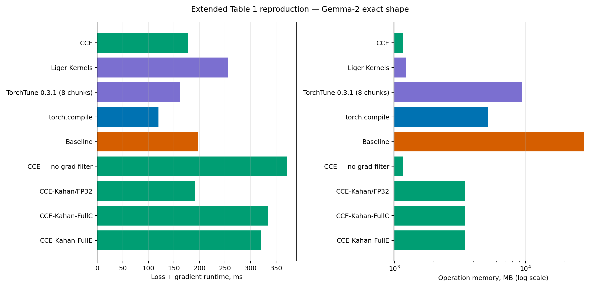
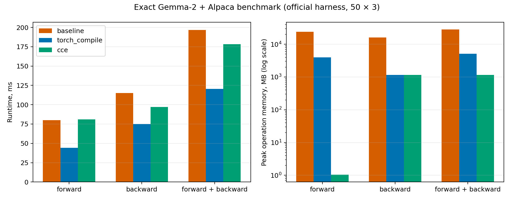
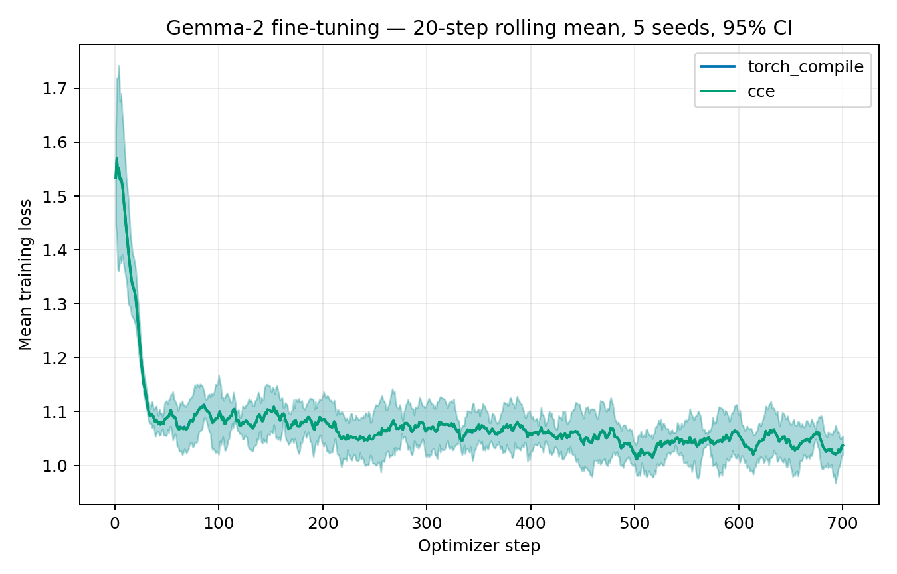
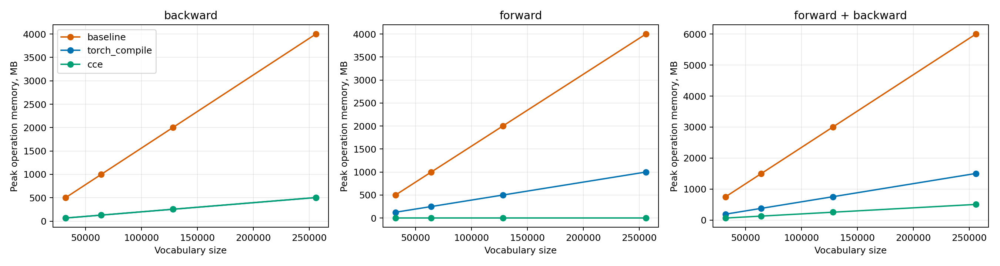
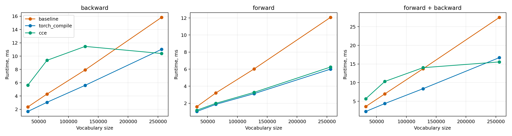
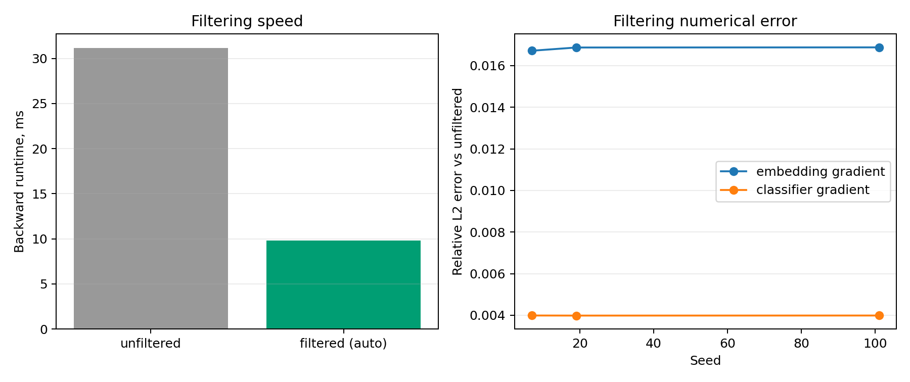
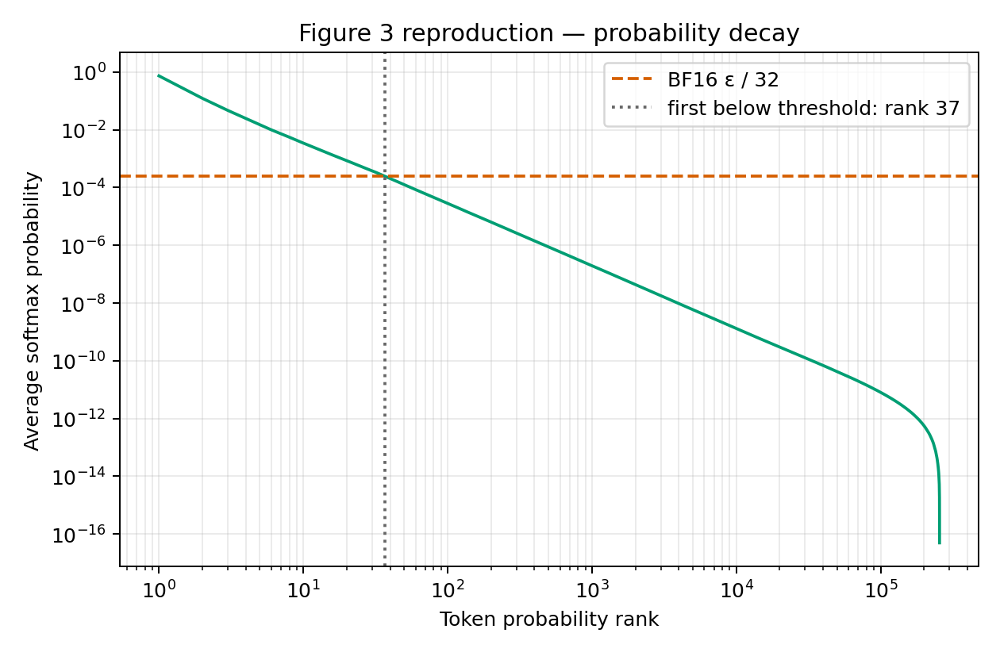

# Воспроизведение результатов Cut Cross-Entropy

Сухова Софья.

Статья: [Cut Your Losses in Large-Vocabulary Language Models](https://arxiv.org/abs/2411.09009).

## Цель работы

В статье предложен Cut Cross-Entropy (CCE): способ вычислять кросс-энтропию
при обучении языковой модели, не сохраняя полную матрицу логитов.
При большом словаре эта матрица занимает значительную часть памяти GPU.
CCE вычисляет логиты небольшими блоками и на форварде сохраняет только
величины, нужные для лосса. На бэкварде логиты вычисляются повторно,
а фильтрация позволяет пропускать блоки с малыми градиентными вкладами.


В этой работе я проверяла три вопроса: насколько результат CCE близок
к обычной кросс-энтропии, сколько памяти он экономит и меняется ли ход
обучения при замене способа вычисления лосса.
Дополнительно проверяла влияние размера словаря и фильтрации.
Полный набор экспериментов статьи не повторялся.

Основной результат: в локальных замерах CCE значительно уменьшил
дополнительную память для вычисления лосса и градиентов. Лосс оказался близок
к обычной кросс-энтропии, а кривые обучения Gemma — к `torch.compile`.
При этом CCE не оказался самым быстрым методом, и небольшая разница
в лоссе после обучения сохранилась.

## Код и условия экспериментов

GPU-ядра CCE взяты из [официального проекта Apple](https://github.com/apple/ml-cross-entropy).
В локальном коде реализованы запуск экспериментов, запись измерений,
проверки, обработка результатов и построение графиков.
То есть это воспроизведение с официальной реализацией, а не написание
собственных ядер CCE с нуля.

Использован коммит `3de376c106a1916bc5e1b619f9c77c87a461ee1c`.
Эксперименты выполнялись на одной NVIDIA A100-SXM4 с 80 ГБ памяти:
Python 3.12.3, PyTorch 2.9.1 с CUDA 12.8, Triton 3.5.1.
Входные веса и скрытые состояния в основных замерах имели тип BF16.
Полное окружение сохранено в [environment.json](../results/raw/environment.json).

Для сравнения памяти и времени использованы веса `google/gemma-2-2b-it`
и скрытые состояния на данных `yahma/alpaca-cleaned`.
Размер задачи соответствует таблице 1 статьи: 8 192 позиции, словарь
из 256 000 токенов, размер скрытого состояния 2 304.
Параметр ограничения логитов Gemma, `softcap`, равен 30.

Версии официального кода и библиотек новее использованных в статье.

## 1. Корректность лосса и градиентов

На случайных входах сравнивались обычная кросс-энтропия, `torch.compile`,
CCE и `cce_exact`. Последний вариант отключает фильтрацию и использует
накопление градиентов в FP32.
Проверены три задачи с разными начальными состояниями генератора (seed) и размерами:
128 / 4 096 / 256, 256 / 8 192 / 512 и 512 / 16 384 / 512.
Числа обозначают количество позиций, размер словаря и размер скрытого состояния.

Сравнивались скалярный лосс и два градиента: по выходным весам и по скрытым
состояниям. Второй нужен, чтобы продолжить бэквард через предыдущие слои модели.

| Показатель по трем задачам | CCE | `cce_exact` |
|---|---:|---:|
| Максимальная абсолютная разница лосса | 9.54 × 10⁻⁷ | 9.54 × 10⁻⁷ |
| Минимальное косинусное сходство градиента скрытых состояний | 0.999847 | 0.999996 |
| Максимальная относительная ошибка этого градиента по L2 | 1.75% | 0.287% |
| Максимальная относительная ошибка градиента выходных весов по L2 | 0.207% | 0.00361% |

Косинусное сходство показывает, насколько совпадают направления градиентов;
относительная ошибка по L2 — насколько велика разница относительно нормы
градиента обычной кросс-энтропии.
Эти показатели дополняют друг друга: близкое направление не означает
полного совпадения всех значений.

На проверенных входах лосс совпадает с точностью порядка 10⁻⁶.
Градиенты близки, но не идентичны. У CCE с фильтрацией ошибка больше,
чем у `cce_exact`, что согласуется с приближенным бэквардом.
Название `exact` также не означает побитового совпадения при вычислениях в BF16.

### Все проверенные случаи

E — скрытые состояния, C — выходные веса. Ошибки L2 указаны в процентах
от нормы градиента обычной кросс-энтропии; Δлосс — абсолютная разница.
В первой колонке после seed идут количество позиций, размер словаря
и размер скрытого состояния.

| Seed: позиции / словарь / размер | Метод | Δлосс | Ошибка E, % | Ошибка C, % | Косинус E | Косинус C |
|---|---|---:|---:|---:|---:|---:|
| 7: 128 / 4096 / 256 | `torch.compile` | 0.000000 | 0.00000 | 0.00000 | 1.000000 | 1.000000 |
| 7: 128 / 4096 / 256 | `cce_exact` | 0.000000 | 0.01899 | 0.000399 | 1.000000 | 1.000000 |
| 7: 128 / 4096 / 256 | CCE | 0.000000 | 0.69755 | 0.000374 | 0.999976 | 1.000000 |
| 19: 256 / 8192 / 512 | `torch.compile` | 0.000000 | 0.00000 | 0.00000 | 1.000000 | 1.000000 |
| 19: 256 / 8192 / 512 | `cce_exact` | 0.000000 | 0.28444 | 0.00153 | 0.999996 | 1.000000 |
| 19: 256 / 8192 / 512 | CCE | 9.54e-07 | 0.99988 | 0.20689 | 0.999950 | 0.999998 |
| 101: 512 / 16384 / 512 | `torch.compile` | 0.000000 | 0.000454 | 3.44e-05 | 1.000000 | 1.000000 |
| 101: 512 / 16384 / 512 | `cce_exact` | 9.54e-07 | 0.28729 | 0.00361 | 0.999996 | 1.000000 |
| 101: 512 / 16384 / 512 | CCE | 0.000000 | 1.74849 | 0.19127 | 0.999847 | 0.999998 |

Косинус округлен до шести знаков; значение 1.000000 не означает
побитового совпадения. Все девять сравнений прошли проверку элементов
градиентов с абсолютным допуском 0.005 и относительным 0.05.

Исходные значения: [correctness.json](../results/raw/correctness.json).

## 2. Память и время

Расширенное сравнение проводилось на входах Gemma указанного выше размера.
Для каждого метода выполнено пять повторов, в каждом — 20 измерений
после прогрева. Ниже приведены все девять оставшихся методов и три фазы:
форвард, бэквард и их совместное выполнение. Локальные значения — медианы
пяти повторов. Время совместного выполнения измерялось отдельно,
поэтому оно не обязано совпадать с суммой двух отдельных времен.
Числа статьи взяты из таблицы 1.
В статье приведены усредненные замеры, здесь — медианы повторов;
это сопоставление результатов, а не парный статистический тест.

| Метод | Фаза | Статья, мс | Здесь, мс | Статья, MB | Здесь, МиБ |
|---|---|---:|---:|---:|---:|
| CCE | Форвард | 46.00 | 80.93 | 1.00 | 1.04 |
| CCE | Бэквард | 100.00 | 95.82 | 1163.00 | 1163.26 |
| CCE | Форвард + бэквард | 145.00 | 177.18 | 1164.00 | 1164.27 |
| Liger Kernels | Форвард | 304.00 | 255.41 | 1474.00 | 1224.54 |
| Liger Kernels | Бэквард | — | 0.37 | — | 0.00195 |
| Liger Kernels | Форвард + бэквард | 304.00 | 255.76 | 1474.00 | 1224.54 |
| TorchTune, 8 частей | Форвард | 55.00 | 56.19 | 8000.00 | 8500.00 |
| TorchTune, 8 частей | Бэквард | 115.00 | 105.22 | 1630.00 | 1386.94 |
| TorchTune, 8 частей | Форвард + бэквард | 169.00 | 161.24 | 9631.00 | 9387.00 |
| `torch.compile` | Форвард | 49.00 | 43.78 | 4000.00 | 4000.06 |
| `torch.compile` | Бэквард | 92.00 | 74.61 | 12000.00 | 1161.94 |
| `torch.compile` | Форвард + бэквард | 143.00 | 119.79 | 16000.00 | 5162.00 |
| Обычная кросс-энтропия | Форвард | 82.00 | 79.88 | 24000.00 | 24000.00 |
| Обычная кросс-энтропия | Бэквард | 122.00 | 114.84 | 16000.00 | 16000.00 |
| Обычная кросс-энтропия | Форвард + бэквард | 208.00 | 196.55 | 28000.00 | 28000.00 |
| CCE без фильтрации | Форвард | 45.00 | 68.05 | 0.09 | 0.0938 |
| CCE без фильтрации | Бэквард | 314.00 | 304.47 | 1163.00 | 1162.28 |
| CCE без фильтрации | Форвард + бэквард | 357.00 | 371.55 | 1162.00 | 1162.32 |
| CCE-Kahan/FP32 | Форвард | 47.00 | 81.14 | 1.00 | 1.04 |
| CCE-Kahan/FP32 | Бэквард | 114.00 | 110.35 | 2325.00 | 3449.26 |
| CCE-Kahan/FP32 | Форвард + бэквард | 160.00 | 191.39 | 2326.00 | 3450.27 |
| CCE-Kahan-FullC | Форвард | 47.00 | 81.29 | 1.00 | 1.04 |
| CCE-Kahan-FullC | Бэквард | 268.00 | 252.14 | 2326.00 | 3449.26 |
| CCE-Kahan-FullC | Форвард + бэквард | 313.00 | 333.48 | 2326.00 | 3450.27 |
| CCE-Kahan-FullE | Форвард | 47.00 | 81.11 | 1.00 | 1.04 |
| CCE-Kahan-FullE | Бэквард | 247.00 | 239.09 | 2326.00 | 3449.26 |
| CCE-Kahan-FullE | Форвард + бэквард | 292.00 | 320.13 | 2326.00 | 3450.27 |

Прочерк означает, что в таблице статьи нет отдельного значения.
Малое время бэкварда Liger не означает почти бесплатное вычисление
градиентов: они заранее вычисляются на форварде.



Измеряется пиковая дополнительная память операции, а не вся память модели.
Веса и скрытые состояния уже находятся на GPU до начала замера.
Локальный измеритель делит число байт на 2²⁰, поэтому здесь указаны МиБ;
в статье столбец подписан MB.

CCE уменьшил память полного вычисления примерно в 24 раза относительно
обычной кросс-энтропии: с 28 000 до 1 164 МиБ.
В отдельной основной серии замеров, с тремя повторами по 50 измерений,
память форварда уменьшилась с 24 000 до 1.04 МиБ.
Это не означает, что вся модель или ее обучение помещаются в 1 МиБ:
измерение относится только к дополнительным выделениям этой операции.

Причина экономии соответствует идее статьи: CCE не записывает полную
матрицу логитов в основную память GPU. Блок логитов используется сразу,
а между блоками сохраняется компактный результат для каждой позиции.
На бэкварде дополнительная память все равно нужна, в частности для градиентов.

По времени CCE здесь примерно на 10% быстрее обычной кросс-энтропии,
но медленнее `torch.compile`: 177.18 против 119.79 мс.
Таким образом, главный выигрыш в этом сравнении — память, а не минимальное
время среди всех методов. Почему времена отличаются от статьи, эти
эксперименты не разделяют: изменились и библиотеки, и официальный код.

У Liger часть вычислений градиентов выполняется уже на форварде.
Поэтому для сопоставления методов здесь используется полный шаг,
а не отдельное время бэкварда.

Сводные измерения: [table1_extended_summary.csv](../results/processed/table1_extended_summary.csv).
Сопоставление со статьей: [table1_paper_comparison.csv](../results/processed/table1_paper_comparison.csv).
В нем также сохранены CCE без фильтрации и три режима накопления в FP32.
Названия этих режимов содержат `Kahan`, но это варианты текущего официального
API, а не восстановление исторических ядер с суммированием Кэхэна из статьи.

### Основная серия: три повтора

Отдельная серия на тех же размерах использует официальный измеритель:
три повтора по 50 измерений после прогрева. Ниже — все ее медианы.
Эта серия не объединялась с пятью повторами расширенной таблицы.

| Метод | Фаза | Время, мс | Дополнительная память, МиБ |
|---|---|---:|---:|
| Обычная кросс-энтропия | Форвард | 79.95 | 24000.00 |
| Обычная кросс-энтропия | Бэквард | 115.04 | 16000.00 |
| Обычная кросс-энтропия | Форвард + бэквард | 196.72 | 28000.00 |
| `torch.compile` | Форвард | 44.21 | 4000.06 |
| `torch.compile` | Бэквард | 75.02 | 1160.94 |
| `torch.compile` | Форвард + бэквард | 120.51 | 5161.00 |
| CCE | Форвард | 81.01 | 1.04 |
| CCE | Бэквард | 97.17 | 1162.26 |
| CCE | Форвард + бэквард | 178.14 | 1163.27 |



Источник: [official_benchmark_summary.csv](../results/processed/official_benchmark_summary.csv).

## 3. Обучение Gemma

Для проверки поведения метода во время обучения сравнивались CCE
и `torch.compile` на Gemma-2-2B-it и Alpaca.
Каждый метод запускался с пятью seed: 7, 19, 42, 101 и 20241113,
по 700 шагов оптимизатора. Всего получено десять запусков.
Внутри каждой пары seed использовались одинаковые исходные веса
и настройки данных; число обработанных токенов по шагам совпадает.

Обучение выполнялось на одной GPU: батч на устройство 2,
накопление градиентов за 4 шага, эффективный батч 8.
Начальная скорость обучения равна 2 × 10⁻⁵; использовались BF16 и
пересчет активаций для экономии памяти.
В статье эксперимент проводился на восьми GPU с глобальным батчем 64.



На графике показан средний лосс по пяти запускам каждого метода,
сглаженный по последним 20 шагам. Полупрозрачные области — 95%-е
доверительные интервалы по запускам.
Для численного сравнения ниже использованы исходные значения без сглаживания.

| Показатель | Результат |
|---|---:|
| Средний лосс CCE за последние 50 шагов | 1.041545 |
| Средний лосс `torch.compile` за последние 50 шагов | 1.040999 |
| Средняя парная разница, CCE минус `torch.compile` | +0.000546 |
| 95%-й доверительный интервал разницы | [+0.000266; +0.000825] |
| Корреляция средних кривых | 0.999940 |
| Среднеквадратичная разница средних кривых (RMSE) | 0.000928 |
| Средняя абсолютная разница средних кривых | 0.000701 |
| Максимальная абсолютная разница средних кривых | 0.006160 |

Для каждой пары seed сначала вычислялась разница средних лоссов
последних 50 шагов. Затем по пяти парным разницам рассчитаны среднее
и доверительный интервал с распределением Стьюдента.

Кривые визуально близки. Однако у CCE лосс в конце немного выше:
разница составляет около 0.052% от лосса `torch.compile`,
а доверительный интервал не включает ноль.
Результат показывает близкий ход обучения, но не строго одинаковый.
Отдельная оценка качества на проверочной выборке не выполнялась.

### Результаты отдельных запусков

Лосс за последние 50 шагов и парная разница для каждого seed:

| Seed | CCE | torch.compile | CCE минус torch.compile |
|---|---|---:|---:|
| 7 | 1.027716 | 1.027372 | +0.000344 |
| 19 | 1.037212 | 1.036670 | +0.000542 |
| 42 | 1.040458 | 1.039878 | +0.000580 |
| 101 | 1.038614 | 1.037712 | +0.000902 |
| 20241113 | 1.063724 | 1.063364 | +0.000360 |

Остальные сводные значения лосса по каждому из десяти запусков:

| Метод | Seed | Средний за 700 шагов | Медиана за 700 шагов | Средний за последние 20 шагов |
|---|---|---:|---:|---:|
| CCE | 7 | 1.066256 | 1.059350 | 1.049305 |
| CCE | 19 | 1.063429 | 1.058500 | 1.026285 |
| CCE | 42 | 1.071739 | 1.069250 | 1.018790 |
| CCE | 101 | 1.070088 | 1.061900 | 1.042590 |
| CCE | 20241113 | 1.072540 | 1.070050 | 1.048830 |
| `torch.compile` | 7 | 1.066246 | 1.058300 | 1.049370 |
| `torch.compile` | 19 | 1.063208 | 1.058300 | 1.026110 |
| `torch.compile` | 42 | 1.071551 | 1.069600 | 1.018145 |
| `torch.compile` | 101 | 1.069877 | 1.061400 | 1.041250 |
| `torch.compile` | 20241113 | 1.072488 | 1.070100 | 1.048305 |

### Время и память всего обучения

Эти значения относятся к шагам всей модели, а не только к выходному слою.
Для времени шага и скорости обработки исключены первые 10 шагов.
Сумма времени всех 700 шагов не включает загрузку модели и подготовку
данных. Пиковая память и резерв памяти PyTorch приведены за весь запуск;
резерв может превышать объем памяти занятых тензоров.
Это вспомогательные измерения, не отдельная оценка скорости ядра CCE.

| Метод | Seed | Сумма времени шагов, с | Средний шаг, мс | Токенов/с | Пик, МиБ | Макс. занято после шага, МиБ | Макс. резерв, МиБ |
|---|---|---:|---:|---:|---:|---:|---:|
| CCE | 7 | 559.93 | 798.44 | 1445.00 | 24987.24 | 14979.23 | 27164.00 |
| CCE | 19 | 557.32 | 794.52 | 1428.16 | 24975.81 | 14981.25 | 27192.00 |
| CCE | 42 | 566.01 | 807.03 | 1424.36 | 24982.85 | 14978.75 | 27100.00 |
| CCE | 101 | 562.80 | 802.77 | 1445.54 | 24987.00 | 14979.73 | 27044.00 |
| CCE | 20241113 | 561.26 | 800.48 | 1413.36 | 24986.03 | 14979.74 | 27044.00 |
| `torch.compile` | 7 | 562.26 | 801.38 | 1439.69 | 24987.22 | 14978.73 | 27156.00 |
| `torch.compile` | 19 | 565.95 | 804.80 | 1409.92 | 24983.27 | 14979.79 | 27142.00 |
| `torch.compile` | 42 | 558.15 | 795.76 | 1444.52 | 24992.06 | 14978.75 | 27108.00 |
| `torch.compile` | 101 | 570.04 | 809.95 | 1432.72 | 24993.10 | 14978.73 | 27102.00 |
| `torch.compile` | 20241113 | 563.71 | 800.81 | 1412.79 | 24988.90 | 14978.74 | 27114.00 |

Источник: [figure4_gemma_runs_summary.csv](../results/processed/figure4_gemma_runs_summary.csv).

Парная статистика: [figure4_gemma_pair_summary.json](../results/processed/figure4_gemma_pair_summary.json).

## Дополнительные проверки

### Увеличение словаря

На случайных входах с 2 048 позициями и скрытым размером 1 024
словарь увеличивался с 32 000 до 256 000 токенов.
Для каждой комбинации метода, размера и операции выполнено 20 измерений.

Память форварда обычной кросс-энтропии выросла с 500 до 4 000 МиБ,
а у CCE оставалась около 0.023 МиБ.
Для полного форварда и бэкварда при словаре 256 000 получено
6 000 МиБ у обычной кросс-энтропии и около 506 МиБ у CCE.
В этой задаче CCE также быстрее: 15.56 против 27.49 мс.
Это подтверждает, что выигрыш зависит от размера задачи:
на 128 000 токенов времена полного вычисления были почти равны.

Все медианные замеры этой серии. Ф — форвард, Б — бэквард,
Ф+Б — совместное выполнение; память — дополнительная пиковая память.

| Словарь | Метод | Ф, мс | Б, мс | Ф+Б, мс | Ф, МиБ | Б, МиБ | Ф+Б, МиБ |
|---|---|---:|---:|---:|---:|---:|---:|
| 32000 | Обычная кросс-энтропия | 1.60 | 2.35 | 3.59 | 500.00 | 500.00 | 750.00 |
| 32000 | `torch.compile` | 1.04 | 1.67 | 2.26 | 126.02 | 66.48 | 191.50 |
| 32000 | CCE | 1.18 | 5.64 | 5.68 | 0.0234 | 66.64 | 66.77 |
| 64000 | Обычная кросс-энтропия | 3.22 | 4.29 | 6.98 | 1000.00 | 1000.00 | 1500.00 |
| 64000 | `torch.compile` | 1.87 | 3.05 | 4.39 | 250.02 | 128.98 | 379.00 |
| 64000 | CCE | 1.99 | 9.36 | 10.31 | 0.0234 | 129.28 | 129.53 |
| 128000 | Обычная кросс-энтропия | 6.02 | 7.92 | 13.72 | 2000.00 | 2000.00 | 3000.00 |
| 128000 | `torch.compile` | 3.13 | 5.60 | 8.37 | 500.02 | 253.98 | 754.00 |
| 128000 | CCE | 3.28 | 11.46 | 14.01 | 0.0234 | 254.55 | 255.05 |
| 256000 | Обычная кросс-энтропия | 12.06 | 15.83 | 27.49 | 4000.00 | 4000.00 | 6000.00 |
| 256000 | `torch.compile` | 6.00 | 11.02 | 16.71 | 1000.02 | 503.98 | 1504.00 |
| 256000 | CCE | 6.25 | 10.39 | 15.56 | 0.0234 | 505.10 | 506.08 |





Сводные значения: [scaling_summary.csv](../results/processed/scaling_summary.csv).

### Фильтрация градиентов

На той же форме с размером словаря 256 000 сравнивались CCE
с автоматической фильтрацией и без нее.
Использованы три seed, по 20 измерений для каждого варианта.
Медианное время бэкварда уменьшилось с 31.15 до 9.80 мс,
то есть примерно в 3.18 раза. Память в обоих случаях — около 505 МиБ.
Максимальная разница лосса составила 9.54 × 10⁻⁷;
минимальное косинусное сходство градиента скрытых состояний — 0.999858.
Фильтрация ускоряет бэквард, но делает его приближенным.

| Вариант | Медиана бэкварда, мс | Дополнительная память, МиБ |
|---|---|---:|
| Без фильтрации | 31.15 | 504.12 |
| Автоматическая фильтрация | 9.80 | 505.10 |

Сравнение градиентов с вариантом без фильтрации для каждого seed:

| Seed | Δлосс | Ошибка E, % | Ошибка C, % | Косинус E | Косинус C |
|---|---|---:|---:|---:|---:|
| 7 | 9.54e-07 | 1.67163 | 0.39879 | 0.999860 | 0.999992 |
| 19 | 9.54e-07 | 1.68715 | 0.39836 | 0.999858 | 0.999992 |
| 101 | 0.000000 | 1.68782 | 0.39866 | 0.999858 | 0.999992 |



### Распределение вероятностей токенов

Дополнительно построена кривая средней вероятности токенов по рангам,
аналогичная рисунку 3 статьи, на входах Gemma.
Первый ранг ниже используемого порога BF16 — 37; в статье описан
переход примерно около 50. Эта кривая иллюстрирует, что у большинства
токенов вероятность мала. Сама по себе она не доказывает, что любой
блок с такими токенами можно пропустить без влияния на обучение.

| Показатель | Значение |
|---|---|
| Число рангов токенов | 256000 |
| Порог фильтрации BF16 | 0.000244140625 |
| Первый ранг ниже порога | 37 |



Данные: [filtering_summary.csv](../results/processed/filtering_summary.csv),
[filtering_correctness.json](../results/raw/filtering_correctness.json)
и [figure3_probabilities.json](../results/raw/figure3_probabilities.json).

## Вывод и границы воспроизведения

Основная идея статьи подтверждается локальными измерениями:
CCE позволяет не хранить полную матрицу логитов и значительно сокращает
дополнительную память. На проверенных входах лосс близок к обычной
кросс-энтропии; фильтрация заметно ускоряет бэквард, внося ошибку
в градиенты. При обучении Gemma получены близкие, но не одинаковые кривые.

Воспроизведены основные сравнения таблицы 1 и часть дополнительных режимов,
распределение вероятностей из рисунка 3 и сравнение двух методов обучения
Gemma из рисунка 4 в уменьшенном режиме.
Влияние сортировки отдельно не оценивалось.
Остальные три модели рисунка 4, предобучение и оценка из рисунка 5,
а также полный набор официальных тестов не воспроизводились.

Объем экспериментов был ограничен доступными ресурсами: использовалась
одна A100. Обучение остальных моделей и длительное предобучение из статьи
на одной GPU потребовали бы значительно больше времени, поэтому приоритет
был отдан проверке основных результатов.

При проверке комплекта сводные таблицы заново рассчитаны из исходных данных;
проверены параметры запусков и полнота журналов.
Повторные GPU-запуски во время этой проверки не выполнялись.

## Как устроен комплект

В `src/` находится код экспериментов, в `scripts/` — команды запуска,
в `configs/` — настройки. `results/raw/` содержит исходные измерения,
а `results/processed/` и `results/figures/` — таблицы и графики из них.

Подробная структура и команды повторного запуска приведены в
[README](../README.md). Сводные таблицы можно пересчитать без GPU:

```sh
make PYTHON=python3 summaries validate
```
